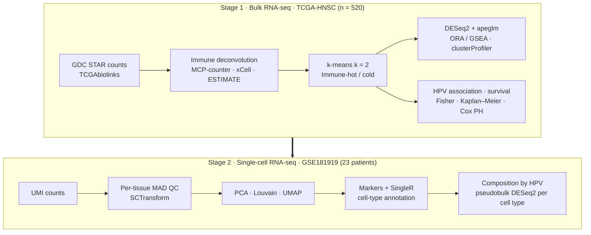
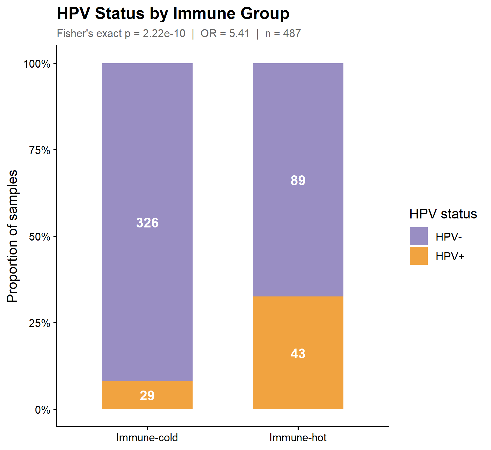
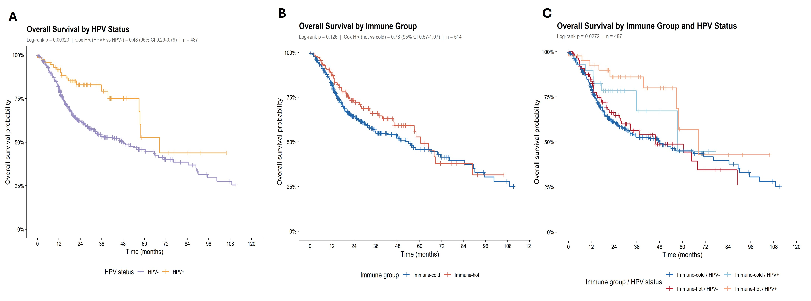
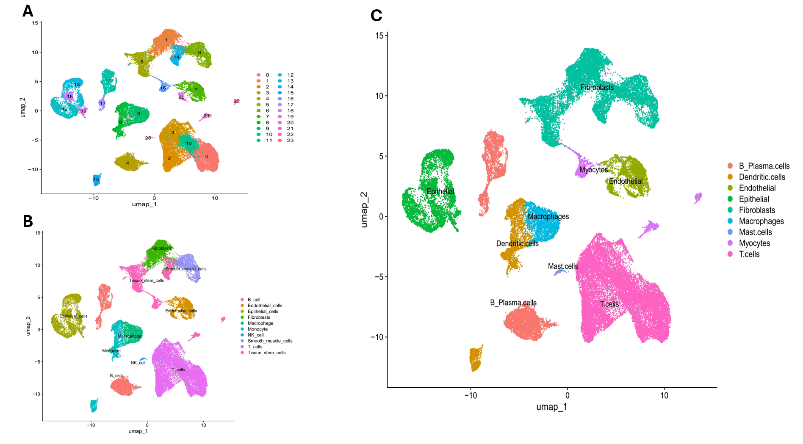

# Characterising Immune-hot and Immune-cold Tumour Microenvironment in Head and Neck Squamous Cell Carcinoma: Integrating TCGA Bulk RNA-Sequencing Immune Deconvolution with Single-Cell Transcriptomic Profiling


*MSc in Precision Medicine thesis, UCD School of Medicine (2026). Analysis pipeline written
in R.* This page gives an overview of the workflow, key figures and methods. The source code
is kept in a private repository and is available on request.

## Abstract

Head and neck squamous cell carcinoma (HNSCC) is a diverse cancer with large differences in its tumour immune microenvironment. HPV-positive tumours often have better clinical outcomes than HPV-negative tumours, but HPV status alone does not fully explain immune variation between patients. This study therefore focused first on immune phenotype, rather than HPV status alone. Using TCGA-HNSC bulk RNA-seq data, immune infiltration was estimated with MCP-counter, ESTIMATE and xCell. Tumours were classified into immune-hot and immune-cold groups. In total, 139 tumours were classified as immune-hot and 381 as immune-cold. Immune-hot tumours showed stronger immune-related signals, including T-cell, B-cell, plasma-cell and antigen-presentation programmes. Immune-cold tumours showed weaker immune activation and relatively stronger metabolic, ribosomal and structural gene-expression programmes.

HPV-positive tumours were significantly enriched in the immune-hot group, but HPV status and immune phenotype were not identical. Many immune-hot tumours were HPV-negative, showing that immune phenotype provides information beyond HPV status. Survival analysis showed that HPV-positive status was associated with better overall survival, while immune-hot/cold status alone was not significantly associated with overall survival.

Single-cell RNA-seq data from GSE181919 were then used to interpret the bulk findings at cell-type level. HPV-associated gene-expression differences were mainly linked to epithelial cells, while B/plasma cells showed the strongest immune-cell-associated signal. Overall, this study shows that HPV status and immune phenotype are related but distinct features of HNSCC biology. Classifying tumours by immune-hot and immune-cold states may help describe tumour immune heterogeneity and guide future studies, but further validation is needed before clinical use.

## Research questions

1. Can immune infiltration patterns in TCGA-HNSC bulk RNA-seq classify tumours into immune-hot
   and immune-cold subtypes, and what genes define these groups?
2. Is HPV positivity significantly enriched in the immune-hot subgroup at the population level?
3. Which single-cell populations and transcriptional programmes are associated with HPV status?

## Workflow



## Key figures

### Figure 1: HPV-positive tumours are enriched in the immune-hot group, but HPV status and immune phenotype are not the same (Stage 1)



*Thesis Figure 5.* Among 487 tumours with known HPV status, HPV-positive tumours made up
**32.6% of the immune-hot group vs 8.2% of the immune-cold group** (Fisher's exact test:
OR = 5.41, 95% CI 3.11–9.54, p = 2.22 × 10⁻¹⁰).

**Interpretation:** most immune-hot tumours (89 of 132, 67.4%) were nonetheless
**HPV-negative**. Immune infiltration is therefore not just a proxy for HPV status, and an
HPV-only classification would miss this immune-hot / HPV-negative subgroup. This finding
supports the immune-phenotype-first approach.

### Figure 2: HPV status, not immune phenotype alone, is associated with overall survival (Stage 1)



*Thesis Figure 6.* Kaplan–Meier overall survival by (A) HPV status, (B) immune group and
(C) both combined. HPV-positive patients had significantly better survival (log-rank
p = 0.0032; Cox HR = 0.48, 95% CI 0.29–0.79). Immune group alone was not significant
(log-rank p = 0.126; HR = 0.78, 95% CI 0.57–1.07).

**Interpretation:** an immune-hot phenotype does not automatically mean better survival.
This may reflect immune activation coexisting with immunoregulation, since immune-hot
tumours also showed higher Treg signals and checkpoint genes such as *BTLA* and *CD96*.
Panel C is exploratory only.

### Figure 3: Single-cell atlas of 53,445 cells resolved into nine cell populations (Stage 2)



*Thesis Figure 7.* (A) Unsupervised Louvain clustering gave 24 clusters. (B) SingleR
reference-based labels. (C) Final annotation into nine populations, combining cluster
markers, canonical lineage markers and SingleR.

**Interpretation:** the clusters separate cleanly by lineage, and SingleR broadly agrees
with the marker-based labels. This provides a reliable cell-type framework for interpreting
the bulk signals. On this framework, HPV-associated expression differences came mainly from
**epithelial cells** (573 DEGs), while **B/plasma cells** showed the strongest
immune-associated signal (*CD79B*, *SYK*, *LRMP* higher in HPV+). This is consistent with the
B-cell signal (*SPIB*, *TLR10*) seen in bulk immune-hot tumours.

## Repository structure (private)

```
.
├── bulk_seq_analysis/          # Stage 1: bulk RNA-seq, run in numeric order
│   ├── 01_download_HNSC_TCGAbiolinks.R          # GDC download (STAR counts)
│   ├── 02_import_HNSC_clinical_2018.R           # clinical / HPV / survival import
│   ├── 03_run_immune_deconvolution.R            # MCP-counter, xCell, ESTIMATE
│   ├── 04_plot_immune_classification.R          # k-means immune-hot / cold classification
│   ├── 05_plot_immune_scores_by_tool.R          # validation across tools
│   ├── 06_run_de_pathway_immune_hot_vs_cold.R   # DESeq2 + GO/KEGG ORA and GSEA
│   ├── 07_visualise_de_immune_hot_vs_cold.R     # volcano, heatmaps
│   ├── 08_correlate_genes_with_immunescore.R    # gene–ImmuneScore correlation
│   └── 09_clinical_association_immune_hot_vs_cold.R  # Fisher, KM, Cox PH
├── scRNA_analysis/             # Stage 2: single-cell RNA-seq
│   └── 01_run_scRNAseq_pipeline.R   # QC → SCTransform → clustering → annotation →
│                                    # HPV composition → pseudobulk DE → ORA / GSEA
└── renv.lock                   # pinned package versions
```

## Methods implemented

### Stage 1: Bulk RNA-seq (TCGA-HNSC)

| Step | Implementation |
|---|---|
| Data | 520 primary tumours (GDC, TCGAbiolinks); raw counts for DESeq2, TPM for deconvolution; clinical data from cBioPortal PanCancer Atlas |
| Immune deconvolution | MCP-counter, ESTIMATE and xCell |
| Immune groups | k-means (k = 2) on seven z-scored MCP-counter immune populations |
| Differential expression | DESeq2 (`~ImmuneGroup`) on raw counts (genes with < 10 total counts removed), apeglm shrinkage; DEGs = BH-adjusted p < 0.05 and abs(log2FC) > 0.5 |
| Pathways | clusterProfiler ORA and GSEA (GO BP, KEGG); GSEA ranked by the DESeq2 Wald statistic |
| Clinical | Fisher's exact test (HPV × immune group); Kaplan–Meier, log-rank, Cox PH |

### Stage 2: Single-cell RNA-seq (GSE181919)

| Step | Implementation |
|---|---|
| Data | 54,239 cells, 23 patients, four tissue compartments (normal, leukoplakia, carcinoma, lymph-node metastasis) |
| QC | 3 × MAD on log10 UMI counts, detected genes and mito%, computed per tissue compartment |
| Normalisation | SCTransform v2 (glmGamPoi), regressing mito% |
| Clustering | PCA (first 20 PCs) → shared-nearest-neighbour graph → Louvain (resolution 0.5) → UMAP |
| Annotation | Cluster markers (FindAllMarkers, Wilcoxon) + canonical lineage markers, cross-checked with SingleR (Human Primary Cell Atlas) |
| Composition | Patient-level proportions, Wilcoxon rank-sum test with BH correction |
| Differential expression | Pseudobulk DESeq2 (`~HPVstatus`): raw counts summed per patient, for all cells and within each cell type (≥ 10 cells per patient, ≥ 3 patients per HPV group); apeglm shrinkage; DEGs = BH-adjusted p < 0.05 and abs(log2FC) > 0.5 |
| Pathways | ORA (GO BP, KEGG) on all-cell and per-cell-type DEGs; GSEA on the all-cell ranking (Wald statistic) |

## Rationale behind the analytical choices

**Immune phenotype first, HPV second.** Many studies split tumours by HPV status first, which
can hide immune differences within both groups. Here, immune groups were defined without
using HPV, and HPV and survival were then tested against them.

**Three deconvolution tools, each with one job.** Each tool uses different reference
signatures and has its own biases, so no single estimate was trusted on its own.
- *MCP-counter* defined the clusters, because its scores are comparable between samples.
- *ESTIMATE ImmuneScore* was used only to **label** the clusters: the cluster with the higher
  score was called hot.
- *xCell* was kept out of both steps and used as an **independent check**.

This separation avoids circular validation, where a group would be "confirmed" by the same
score that defined it.

**Seven immune populations for clustering, three held out.** Clustering used only lymphoid
and myeloid immune populations. Neutrophils, endothelial cells and fibroblasts were held out
as comparison populations, so that the split reflects immune infiltration rather than stromal
content. Scores were z-scored so that no single cell type dominates the k-means distance.

**k-means with k = 2.** The hot/cold framework is widely used and easy to interpret. Bulk data
cannot capture the third, spatial "immune-excluded" phenotype, so a two-group split was the
appropriate scope.

**DESeq2 with apeglm shrinkage.** DESeq2 models raw counts with a negative binomial
distribution. apeglm shrinks unreliable fold changes from low-count genes, making gene
rankings and volcano plots more trustworthy without changing the p-values.

**Per-compartment QC.** Normal mucosa, leukoplakia, carcinoma and lymph-node tissue have
different sequencing characteristics. Adaptive MAD thresholds within each compartment avoid
over-filtering tissues with naturally lower RNA content.

**Markers first, SingleR as a cross-check.** Cluster markers and canonical genes (*CD3D*,
*CD79A*, *MZB1*, *CD68*, *EPCAM*, *DCN*, …) set the labels. SingleR provided an independent,
reference-based check rather than the final answer.

**Patient as the unit of replication.** Cells from the same patient are not independent, so
treating thousands of cells as replicates inflates significance. Composition was therefore
tested on per-patient proportions. HPV-associated differential expression, for all cells and
within each cell type, used patient-level pseudobulk DESeq2 rather than cell-level tests such
as Wilcoxon or MAST.

## Validation

- **Independent tool:** xCell, which was not used for clustering or labelling, confirmed broad
  enrichment of adaptive and myeloid immune signals in immune-hot tumours.
- **Honest negatives:** the MCP-counter NK-cell difference was *not* reproduced by xCell
  (p = 0.77), so NK cells were not treated as a robust discriminator.
- **Held-out populations:** neutrophils and fibroblasts did not differ between groups, which
  confirms that the split is immune-driven.
- **Annotation:** labels were supported by three lines of evidence (cluster markers, canonical
  markers, SingleR) and checked with violin plots.
- **Statistical safeguards:** BH multiple-testing correction, patient-level testing and
  pseudobulk DE.

## Reproducibility practices

- Scripts numbered in run order, one analysis stage per script
- All paths relative to the project root, with no machine-specific paths
- Package versions pinned with [`renv`](https://rstudio.github.io/renv/)
- Checkpoints saved after expensive steps (SCTransform, clustering), so the pipeline can
  resume after a failure
- Raw data and outputs kept out of version control

## Acknowledgements

Principal Supervisor: **Asst. Prof. Arman Rahman** · Supervisor: **Dr. Mahsa Mirzaei**.

## Access

The full source code is available on request.
